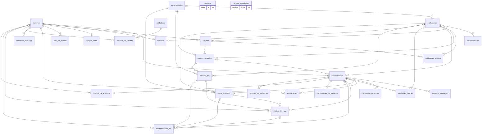
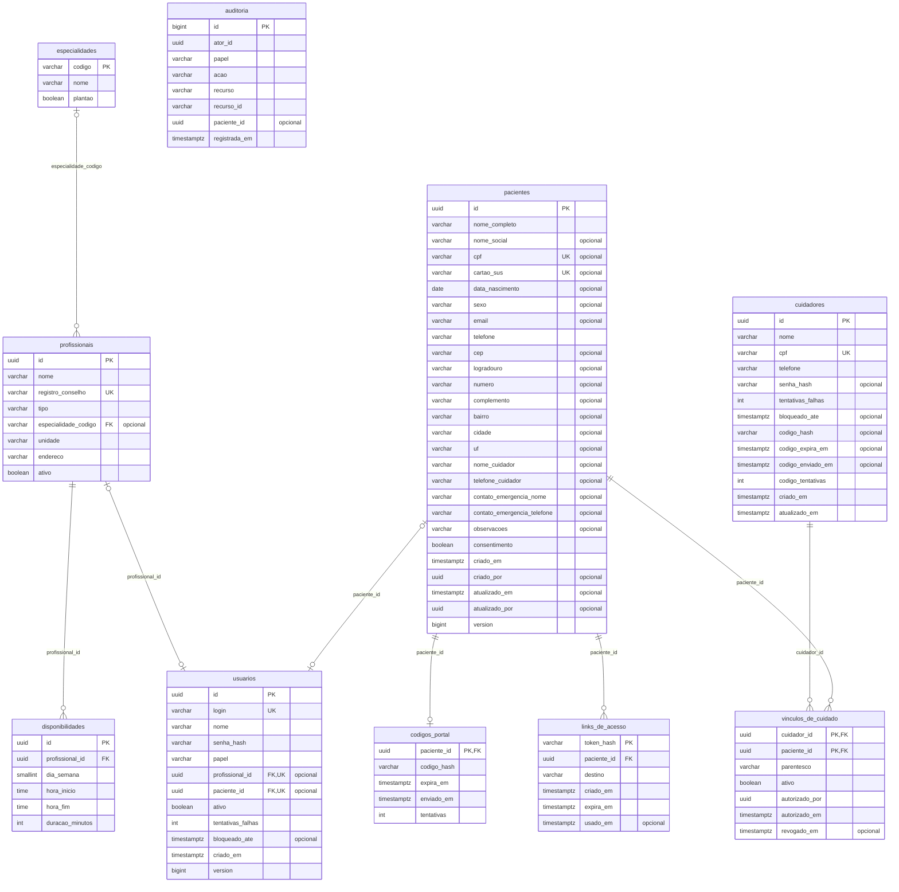
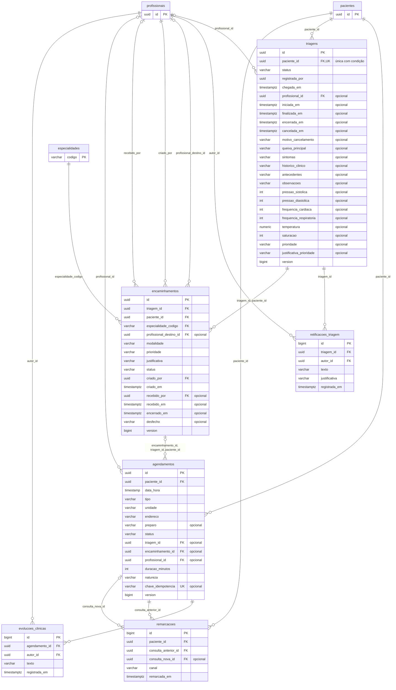
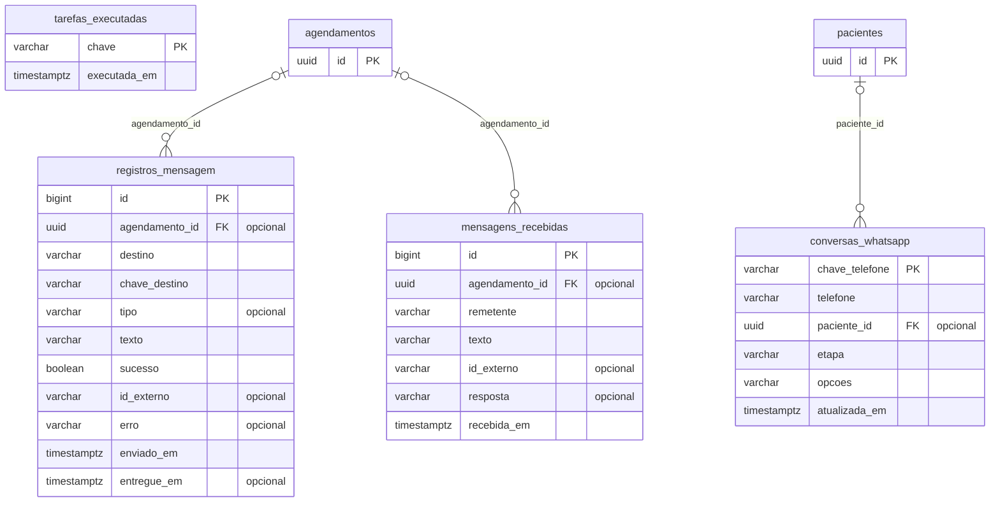
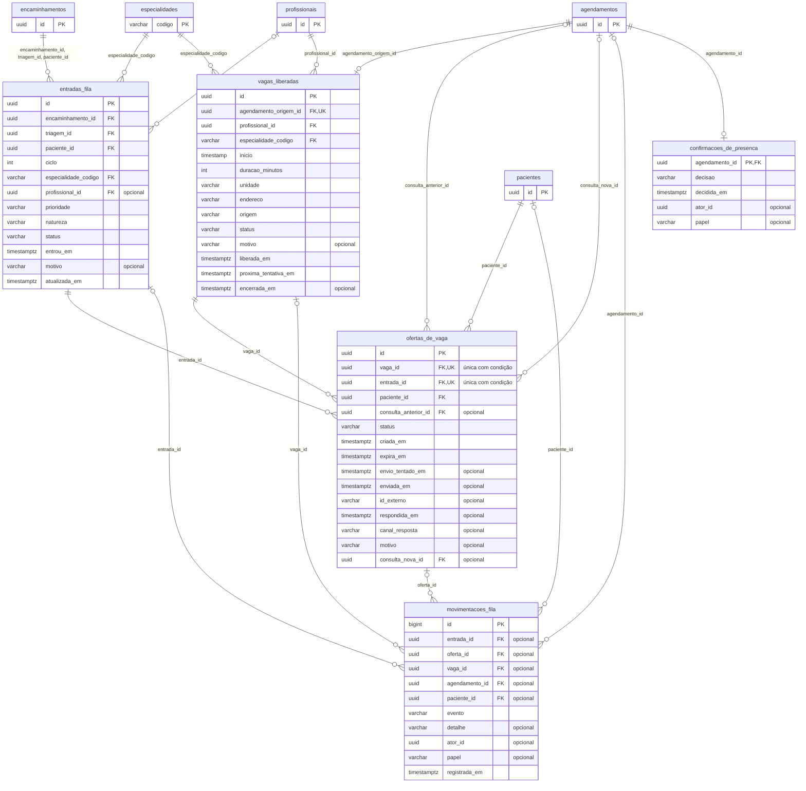
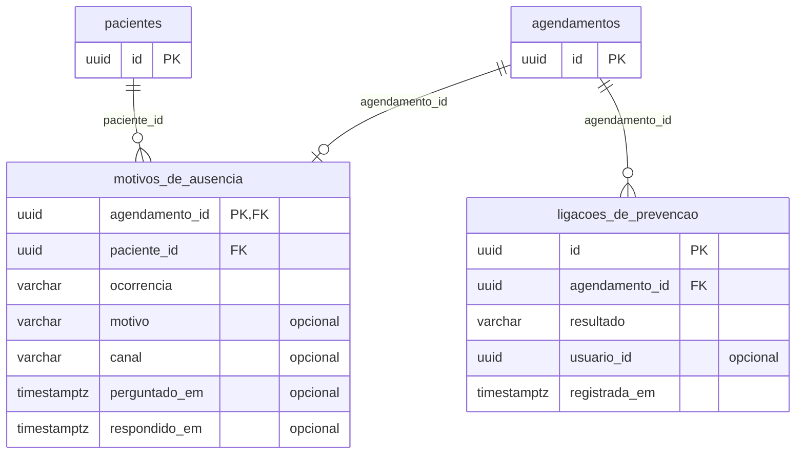

# Diagrama relacional do banco

Gerado a partir do esquema do PostgreSQL por `scripts/diagrama-do-banco.py`: 27 tabelas, 264 colunas e 48 chaves estrangeiras. A tabela de controle do Flyway não aparece.

Como ler:

- `PK` é a chave primária, `FK` é a chave estrangeira e `UK` é um valor que não se repete.
- `||--o{` é um para muitos; `||--o|` é um para no máximo um.
- `|o` do lado de cima quer dizer que a ligação é opcional: a coluna pode ficar vazia.
- "única com condição" vale só para parte das linhas, por exemplo apenas as ativas.

## Visão geral

Todas as tabelas e como se ligam. As colunas estão nas seções seguintes.

## Cadastro, acesso e auditoria

Quem é atendido, quem trabalha na unidade, como cada um entra no sistema e o registro de tudo o que a equipe faz.

## Fluxo assistencial

Da chegada na unidade à consulta com o especialista: triagem, encaminhamento, agendamento, evolução e remarcação.

Tabelas de outras áreas aparecem só com a chave primária: `especialidades`, `pacientes`, `profissionais`.

## WhatsApp e lembretes

Mensagens enviadas e recebidas, a conversa com o assistente e as rotinas automáticas.

Tabelas de outras áreas aparecem só com a chave primária: `agendamentos`, `pacientes`.

## Fila de espera e reaproveitamento de vagas

Quem espera por cada especialidade, os horários liberados, as ofertas feitas e o histórico da fila.

Tabelas de outras áreas aparecem só com a chave primária: `agendamentos`, `encaminhamentos`, `especialidades`, `pacientes`, `profissionais`.

## Prevenção de faltas

Por que a pessoa faltou ou cancelou e o resultado das ligações da equipe.

Tabelas de outras áreas aparecem só com a chave primária: `agendamentos`, `pacientes`.

